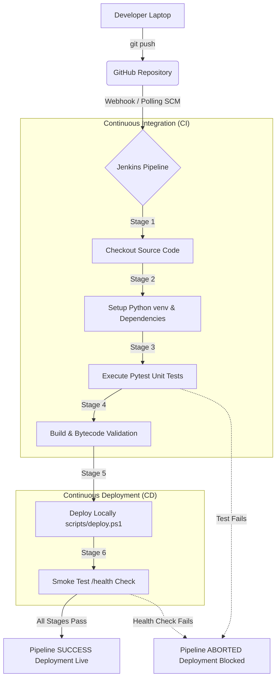

# Automated CI/CD Pipeline using Jenkins, Python, and GitHub

[]()
[](https://www.python.org/)
[](https://flask.palletsprojects.com/)
[](https://docs.pytest.org/)
[](https://www.jenkins.io/)

A complete, production-grade, and beginner-friendly DevOps Continuous Integration and Continuous Deployment (CI/CD) project built for Windows. Designed specifically for demonstration and defense during DevOps internship interviews (such as at **Keysight Technologies**).

---

## Table of Contents

1. [Project Overview](#1-project-overview)
2. [Architecture & Pipeline Flow](#2-architecture--pipeline-flow)
3. [Technology Stack](#3-technology-stack)
4. [Folder Structure](#4-folder-structure)
5. [Prerequisites](#5-prerequisites)
6. [Local Environment Setup (Step-by-Step)](#6-local-environment-setup-step-by-step)
7. [Running the Application & Tests Manually](#7-running-the-application--tests-manually)
8. [Pushing to GitHub](#8-pushing-to-github)
9. [Jenkins Installation & Configuration on Windows](#9-jenkins-installation--configuration-on-windows)
10. [Setting Up the Pipeline Job in Jenkins](#10-setting-up-the-pipeline-job-in-jenkins)
11. [Automating Builds: Webhooks vs. Polling](#11-automating-builds-webhooks-vs-polling)
12. [Pipeline Failure Scenarios & Troubleshooting](#12-pipeline-failure-scenarios--troubleshooting)
13. [Screenshots to Capture for Your Portfolio / Interview](#13-screenshots-to-capture-for-your-portfolio--interview)
14. [DevOps Interview Preparation (Top 15 Questions & Answers)](#14-devops-interview-preparation-top-15-questions--answers)
15. [Future Roadmap & Production Improvements](#15-future-roadmap--production-improvements)

---

## 1. Project Overview

Manual testing and deployments are slow, error-prone, and risky. In modern software engineering, automated CI/CD pipelines ensure that every single code commit is automatically validated, tested, packaged, and verified before reaching users.

This project delivers a complete, end-to-end automated pipeline:
- **Continuous Integration (CI):** Whenever a developer commits code to GitHub, Jenkins automatically triggers a build, sets up an isolated Python virtual environment, installs dependencies, validates syntax, and runs unit tests using Pytest.
- **Continuous Deployment (CD):** If and only if all tests pass with zero errors, Jenkins executes an automated deployment script (`deploy.ps1`), stops any previous instance safely, spins up the new application version, and performs an automated **Smoke Test (HTTP Health Check)**. If any stage fails, the pipeline aborts immediately and alerts the developer.

---

## 2. Architecture & Pipeline Flow

### System Architecture Diagram



### Detailed Pipeline Stages

| Stage | Name | Action Performed | What Happens If It Fails? |
| :--- | :--- | :--- | :--- |
| **1** | **Checkout** | Clones/fetches the latest commit SHA from GitHub. | Pipeline stops if GitHub repo is unreachable or credentials fail. |
| **2** | **Install Dependencies** | Initializes a virtual environment (`venv`) and installs packages from `requirements-dev.txt`. | Halts if a package is incompatible or missing on PyPI. |
| **3** | **Run Tests** | Runs `pytest test_app.py -v --junitxml=reports/test-results.xml`. | **Fails the build immediately.** Broken code never reaches deployment. |
| **4** | **Build & Validate** | Compiles Python files to bytecode (`python -m py_compile app.py`). | Catches syntax errors before execution. |
| **5** | **Deploy** | Executes `scripts/deploy.ps1` to stop old processes and start Flask in background. | Fails if port is blocked, permissions are denied, or script crashes. |
| **6** | **Smoke Test** | Queries `GET http://127.0.0.1:5000/health` with retry backoff. | Marks pipeline failed if the server crashed on startup or returns non-200. |

---

## 3. Technology Stack

- **Application:** Python 3 (3.10+ / 3.13), Flask (Micro web framework)
- **Automated Testing:** Pytest (Fixture-based unit testing & assertions), Pytest-Cov (Coverage reporting)
- **Version Control:** Git, GitHub
- **Automation / Orchestration:** Jenkins (Declarative Pipeline with `Jenkinsfile`)
- **Scripting & Process Management:** Windows PowerShell (`deploy.ps1`, `stop.ps1`), Bash (`deploy.sh`, `stop.sh`)

---

## 4. Folder Structure

```text
devops-cicd-project/
├── .gitignore               # Excludes virtual environments, caches, logs, and PID files
├── app.py                   # Production Flask application with /, /health, /version routes
├── test_app.py              # Pytest unit tests for all endpoints and error handlers
├── requirements.txt         # Production dependencies (Flask)
├── requirements-dev.txt     # Development and testing dependencies (Pytest, Coverage)
├── Jenkinsfile              # Declarative CI/CD pipeline definition for Jenkins
├── README.md                # Comprehensive project documentation & interview guide
└── scripts/
    ├── deploy.ps1           # Windows PowerShell script: starts app in background, tracks PID
    ├── stop.ps1             # Windows PowerShell script: safely terminates running app
    ├── deploy.sh            # Linux/Bash deployment equivalent
    └── stop.sh              # Linux/Bash stop equivalent
```

### Why each file exists:
- **`app.py`:** Contains the web application logic with strict REST status codes, JSON formatting, and error handlers.
- **`test_app.py`:** Automated test suite utilizing Flask's `test_client()` to simulate requests without binding ports.
- **`requirements.txt` vs. `requirements-dev.txt`:** Standard DevOps separation of concerns. Production servers only install runtime dependencies, while CI agents install testing utilities.
- **`Jenkinsfile`:** Defines "Pipeline as Code," enabling version-controlled, reproducible automation.
- **`scripts/deploy.ps1`:** Manages zero-downtime process restart: inspects `app.pid`, frees port 5000 if occupied, redirects output to `app.log` / `app.err.log`, launches the background process, and records the new PID.

---

## 5. Prerequisites

Before starting, ensure you have the following on your Windows 10/11 system:

1. **Python 3.10 or higher:** [python.org/downloads](https://www.python.org/downloads/) *(Check "Add python.exe to PATH" during installation)*
2. **Git for Windows:** [git-scm.com/download/win](https://git-scm.com/download/win)
3. **Java Development Kit (JDK) 17 or 21 (LTS):** Required to run Jenkins. Recommended: Eclipse Temurin JDK 17 or 21 from [adoptium.net](https://adoptium.net/)

---

## 6. Local Environment Setup (Step-by-Step)

Open **PowerShell** as Administrator or a standard user terminal and run:

### Step 1: Verify Prerequisites
```powershell
python --version
git --version
```
*Expected Output:*
```text
Python 3.13.x (or 3.10+)
git version 2.4x.x
```

### Step 2: Navigate to Project Directory
```powershell
cd D:\devops_project
```

### Step 3: Create and Activate Virtual Environment
```powershell
python -m venv venv
.\venv\Scripts\Activate.ps1
```
*(If PowerShell blocks script execution, run `Set-ExecutionPolicy -Scope Process -ExecutionPolicy Bypass` first).*

### Step 4: Install Dependencies
```powershell
python -m pip install --upgrade pip
pip install -r requirements-dev.txt
```

---

## 7. Running the Application & Tests Manually

### 1. Run Unit Tests with Pytest
```powershell
pytest test_app.py -v
```
*Expected Output:*
```text
============================= test session starts =============================
collected 5 items

test_app.py::test_home_endpoint PASSED                                   [ 20%]
test_app.py::test_health_endpoint PASSED                                 [ 40%]
test_app.py::test_version_endpoint PASSED                                [ 60%]
test_app.py::test_not_found_endpoint PASSED                              [ 80%]
test_app.py::test_method_not_allowed PASSED                              [100%]

============================== 5 passed in 0.70s ==============================
```

### 2. Run Application Locally
```powershell
python app.py
```
Open your browser or run another PowerShell window:
- Homepage: `http://127.0.0.1:5000/`
- Health check: `http://127.0.0.1:5000/health`
- Version info: `http://127.0.0.1:5000/version`

### 3. Test Automated Deployment Script
```powershell
# Deploy application in background
powershell.exe -ExecutionPolicy Bypass -File .\scripts\deploy.ps1 -Port 5000 -HostAddress 127.0.0.1

# Verify running process
Invoke-RestMethod -Uri "http://127.0.0.1:5000/health"

# Stop application
powershell.exe -ExecutionPolicy Bypass -File .\scripts\stop.ps1 -Port 5000
```

---

## 8. Pushing to GitHub

1. Create a new public or private repository on GitHub named `devops-jenkins-cicd`.
2. In PowerShell, link and push your code:
```powershell
git add .
git commit -m "feat: initial commit of automated CI/CD pipeline and Flask app"
git branch -M main
git remote add origin https://github.com/jay-sanajay/devops-jenkins-cicd.git
git push -u origin main
```

---

## 9. Jenkins Installation & Configuration on Windows

There are two straightforward ways to run Jenkins on Windows. The **Standalone WAR method** is the fastest, cleanest, and avoids background service permission traps.

### Method A: Standalone WAR File (Recommended for Local Dev & Interviews)

1. Download `jenkins.war` (LTS version) from [jenkins.io/download](https://www.jenkins.io/download/).
2. Move `jenkins.war` to a clean folder (e.g. `C:\Jenkins`).
3. Open PowerShell and run:
   ```powershell
   java -jar C:\Jenkins\jenkins.war --httpPort=8080
   ```
4. Keep this terminal open. Jenkins will initialize and print an initial administrator password:
   ```text
   Jenkins initial setup is required. An admin user has been created...
   Please use the following password to proceed to installation:
   4a83b27c62d14f488f219b67484df00e
   ```
5. Open your browser and navigate to: `http://localhost:8080`
6. Paste the administrator password.
7. Click **"Install suggested plugins"** (installs Git, Pipeline, JUnit, Workspace, etc.).
8. Create your First Admin User (e.g., `admin` / `Password123!`).

---

## 10. Setting Up the Pipeline Job in Jenkins

1. On the Jenkins Dashboard, click **New Item**.
2. Enter Item Name: `devops-python-pipeline`.
3. Select **Pipeline** and click **OK**.
4. Scroll down to the **Pipeline** configuration section:
   - **Definition:** Select `Pipeline script from SCM`.
   - **SCM:** Select `Git`.
   - **Repository URL:** Enter your GitHub repo URL: `https://github.com/jay-sanajay/devops-jenkins-cicd.git`.
   - **Credentials:** If your repo is public, leave as `none`. If private, add your GitHub Personal Access Token (PAT).
   - **Branch Specifier:** Change `*/master` to `*/main`.
   - **Script Path:** Ensure it is set to `Jenkinsfile`.
5. Click **Save**.
6. Click **Build Now**.
7. Click on the build number (e.g. `#1`) -> **Console Output** to watch the real-time execution across all 6 stages.

---

## 11. Automating Builds: Webhooks vs. Polling

In an interview, you must clearly articulate how Jenkins knows that code was pushed:

### Option 1: Polling SCM (Simplest & Best for Local Laptops)
Because your laptop is behind a home router or NAT network, GitHub servers cannot directly reach `http://localhost:8080` without tunneling.
- In your Jenkins job configuration, check **Poll SCM** under **Build Triggers**.
- Enter schedule: `H/2 * * * *` (checks GitHub every 2 minutes for new commits).
- When you push to GitHub, Jenkins automatically detects the new commit SHA and triggers the build.

### Option 2: GitHub Webhooks (Production Standard)
In production, Jenkins runs on a cloud server with a public IP or domain.
1. When you `git push`, GitHub sends an HTTP POST JSON payload to:
   `http://<JENKINS_URL>/github-webhook/`
2. Jenkins immediately triggers the pipeline with zero delay.
3. *Testing webhooks locally:* You can expose your local port 8080 to the internet using **ngrok**:
   ```powershell
   ngrok http 8080
   ```
   Add the generated forwarding URL `https://<ngrok-id>.ngrok-free.app/github-webhook/` in your **GitHub Repository Settings -> Webhooks**.

---

## 12. Pipeline Failure Scenarios & Troubleshooting

Understanding failure scenarios is what separates a student who watched a tutorial from an engineer who actually built it.

```text
+-----------------------------------------------------------------------------------+
|                              PIPELINE HEALTH RADAR                                |
+------------------------------------+---------------------+------------------------+
| Scenario                           | Stage Affected      | Immediate Fix          |
+------------------------------------+---------------------+------------------------+
| 1. Unit Test Assertion Fails       | Stage 3 (Run Tests) | Fix app logic or test  |
| 2. Dependency Not in requirements  | Stage 2 (Install)   | Add package to reqs    |
| 3. Python Not in System PATH       | Stage 2 (Install)   | Add Python to PATH/Env |
| 4. Port 5000 Already in Use        | Stage 5 (Deploy)    | deploy.ps1 clears port |
| 5. Endpoint Returns 500 or Crashes | Stage 6 (Smoke Test)| Inspect app.err.log    |
| 6. GitHub Push Doesn't Trigger     | Build Trigger       | Check Polling/Webhook  |
+------------------------------------+---------------------+------------------------+
```

### Scenario 1: Pytest Unit Test Fails
- **How to simulate:** In `app.py`, change `APP_VERSION = "2.0.0"`. Push to GitHub without updating `test_app.py` (which expects `"1.0.0"`).
- **Console Output:**
  ```text
  FAILED test_app.py::test_version_endpoint - AssertionError: assert '2.0.0' == '1.0.0'
  [Pipeline] }
  ERROR: script returned exit code 1
  [Pipeline] // stage
  [Pipeline] End of Pipeline
  Finished: FAILURE
  ```
- **Result:** Stage 3 terminates with exit code 1. Stages 4 (Build), 5 (Deploy), and 6 (Smoke Test) are **never executed**. The broken version never touches production.

### Scenario 2: Python Command Not Found
- **Symptom:** `The term 'python' is not recognized as the name of a cmdlet...`
- **Root Cause:** Python was installed without checking "Add python.exe to PATH", or the Jenkins service user lacks PATH access.
- **Solution:** Add Python directory (`C:\Users\<User>\AppData\Local\Programs\Python\Python313`) and `Scripts` to Windows System Environment Variables. Restart Jenkins.

### Scenario 3: Application Fails to Start (Import Error / Crash)
- **Symptom:** Stage 5 or Stage 6 fails with `Health check failed to receive healthy status`.
- **Where to look:** View `app.err.log` and `app.log` in the Jenkins workspace folder. The exact Python traceback will be preserved.

---


- [ ] **Dockerization:** Package the Flask app inside a multi-stage Docker image (`Dockerfile`).
- [ ] **Static Code Analysis:** Add `flake8` or `black` for PEP8 formatting checks and `bandit` for security vulnerability scanning.
- [ ] **Automated Rollback:** If the smoke test fails, automatically revert to the previously working PID or container tag.
- [ ] **Slack / Email Notifications:** Send pipeline status alerts to a communication channel upon build failure.
- [ ] **Cloud Deployment:** Deploy to AWS EC2 or Elastic Beanstalk using Jenkins AWS credentials.
